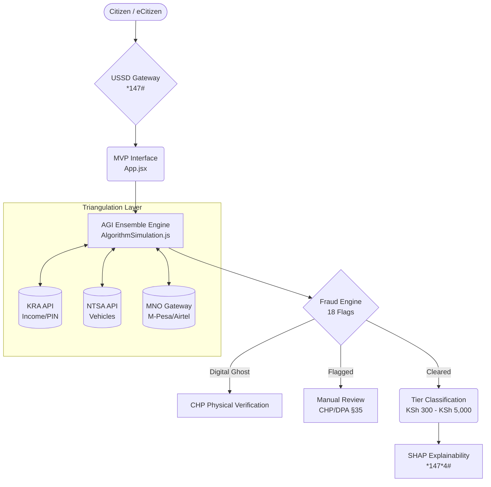

# SHA PMT v2.1 — Fixing Kenya's Health Insurance Algorithm

**Social Health Authority (SHA) Means-Testing Algorithm Reform**

An evidence-based proposal to replace Kenya's opaque linear-regression Proxy Means Test (PMT) algorithm with a transparent, constitutionally compliant Adjusted Gross Income (AGI) model.

---

## The Problem

Kenya's Social Health Authority deployed a linear-regression Proxy Means Test (PMT) algorithm—developed using the 2021 Kenya Continuous Household Survey (KCHS, ~17,000 households) with 43 variables across separate urban and rural submodels predicting log per-capita consumption. 

An independent econometric reconstruction of SHA's model by *Lighthouse Reports* (May 2026), in collaboration with *Africa Uncensored* and *The Guardian*, revealed severe structural inaccuracies:
- **Overpredicts consumption for the poorest:** Among the poorest households, approximately 16% are classified correctly, while about 80% have their consumption overpredicted—subjecting indigent families to premiums they cannot afford.
- **Severe rural-urban disparity:** The model achieves an $R^2$ of **0.66** for the urban submodel, but drops to **0.46** for the rural submodel, meaning more than half the variance in rural household living standards is unaccounted for.
- **Large-scale misclassification:** Among the bottom 40% of households, 39% are erroneously predicted to fall above that welfare band. In the bottom 25%, more than half are misclassified upward.
- **Systematic demographic penalties:** Poor households with basic electricity access and poor female-headed households are significantly more likely to be misclassified as non-poor (modeling in Lighthouse Reports' interactive audit identified exclusion errors reaching 56% for electrified poor households and 65% for female-headed poor households, compared to 34% for male-headed households).
- **Methodological caveats:** As noted by Lighthouse Reports, this analysis reflects an external reconstruction of the disclosed formula and variables; real-world self-reporting and field verification could affect live scores; and the study evaluated the existing regression without benchmarking PMT against alternative targeting architectures.

### Pre-Deployment Warnings & IDinsight Review

The model's inequities were documented before rollout:
- **Internal warnings:** A previously unpublished report by global advisory firm IDinsight, completed shortly before the October 2024 launch, found the model inequitable—particularly for low-income households—and warned that the 2021 KCHS training dataset was outdated.
- **Fundamentally flawed architecture:** Investigative reporting by *Africa Uncensored* revealed that consultants viewed the resulting inequities as structural deficiencies that could not fundamentally be corrected through minor parameter tuning.
- **Alternative design limitations:** Lighthouse Reports also tested IDinsight's proposed two-step logistic design and found it yielded lower overall classification accuracy (47% placed in the correct final band, compared to 54% for the linear OLS model), demonstrating that swapping statistical models without instituting statutory deduction baselines and procedural safeguards remains insufficient.

### Transparency & Algorithmic Opacity

- **Access to Information request (2025):** In August 2025, *Africa Uncensored* formally requested the model's mathematical formula, input variables, and weighting coefficients under the Access to Information Act.
- **Ombudsman direction:** After SHA failed to acknowledge the request, the Commission on Administrative Justice (CAJ / Ombudsman) ordered SHA to respond.
- **Withheld coefficients:** In November 2025, SHA disclosed the 43 variables and model formula, but withheld the regression coefficients, leaving the empirical weights used to assess household wealth concealed from the public.

### Parliamentary & Judicial Interventions

- **Health Committee findings (March 2026):** The National Assembly Health Committee cautioned SHA officials that the fund faces grave sustainability risks, reporting monthly collections of approximately KSh 7.4 billion against recurrent costs of roughly KSh 7.2 billion, leaving virtually no margin for operational shocks. An earlier committee inquiry found that SHA had failed to implement transparent means testing as required by Section 27(2)(c) of the Social Health Insurance Act, and noted that mandatory lump-sum annual premiums excluded low-income households. *(Note: This project argues that informal-sector non-compliance is driven in substantial part by unaffordable algorithmic assessments and procedural opacity).*
- **High Court structural interdict (March 19, 2026):** In a constitutional challenge to the rollout, Justice Bahati Mwamuye held that the October 2024 implementation violated constitutional rights to health and dignity. While declining to suspend the health scheme outright, the court issued a 90-day structural interdict ordering the Ministry of Health to file a comprehensive affidavit detailing corrective measures—including emergency-treatment safeguards—and criticised the transparency of the health technology procurement.

---

## The Solution — AGI Model (v2.1)

The AGI model applies **7 evidence-based deductions** to the assessed consumption base prior to calculating the statutory 2.75% contribution rate, adjusting the assessment base rather than the rate:

| Deduction | Description |
|---|---|
| ASAL Land Discount | 85% valuation reduction for arid and semi-arid land holdings |
| Dependency Allowance | 8% reduction per dependent, capped at 35–40% |
| CHE Exemption | Catastrophic health expenditure protection for households managing chronic illness |
| Digital Debt Exclusion | Mobile credit defaults (e.g. Fuliza, M-Shwari) deducted from asset calculations |
| Household Expense Float | County-level cost-of-living adjustments |
| Tools of Trade | Productive income-generating assets depreciated rather than penalised as luxury wealth |
| Fiduciary Exemption | Community group and chama savings excluded from personal income |

### Revenue Modeling & Informal Sector Participation

- **Demographic baseline:** Kenya has approximately 16.7 million eligible informal-sector workers (drawn from an estimated 12–14 million total households, with 12.2 million recorded in the 2019 KNBS Census).
- **Current revenue imbalance:** Formal-sector PAYE employees (~3.3 million contributors) contribute roughly KSh 73 billion annually against SHA's KSh 102 billion target, while informal compliance has lagged severely (early administrative data reported fewer than 200,000 paying informal members contributing ~KSh 780 million).
- **Beyond nominal premium tiers:** In May 2026, SHA stated that 92% of assessed informal households are assigned premiums of KSh 850 or less (45% between KSh 300–500 and 47% between KSh 501–850). However, compliance is dictated not merely by the sticker price, but by citizen trust in the fairness of the assessment and how contributions are structured.
- **AGI revenue projection:** Modeled at a realistic 60% compliance benchmark among informal workers (drawing on regional community-based health financing experiences, such as Rwanda's CBHI tiering and community mobilization), an average monthly assessment of **KSh 520** yields an estimated **~KSh 58 billion annually** in predictable informal contributions, providing the revenue stability required to support universal health coverage.

---

## Policy Context (2025–2026)

This reform aligns with major policy, judicial, and statistical developments across Kenya's healthcare transition:

- **Lipa SHA Pole Pole (Live since July 2025):** SHA's installment payment mechanism, integrated with the Hustler Fund's insurance premium financing platform, enables informal-sector members to spread annual premiums over up to 24 months. The program requires the first four months' premium upfront, with the remaining 20 months paid in daily, weekly, or monthly installments via M-Pesa Ratiba or USSD. However, individuals with existing SHA arrears or Hustler Fund loans overdue past 45 days are disqualified. At v2.1's projected KSh 520 average monthly assessment, an upfront four-month deposit (~KSh 2,080) remains a potential barrier for ultra-low-income households unless paired with zero-deposit or subsidized entry tiers.
- **Ombudsman Payment-Records Order (July 2026):** On an application dated Nov 19, 2025, the Commission on Administrative Justice ordered SHA to release within 21 days disaggregated hospital reimbursement records (NHIF disbursements from 2018–2024 and SHA/SHIF payments from 2025 onward). While that ruling enforces provider payment transparency, this repository delivers **algorithmic transparency** for household means testing.
- **KIHBS 2025/26 Recalibration Opportunity:** The Kenya National Bureau of Statistics (KNBS) commenced a 12-month national fieldwork campaign for the 2025/26 Kenya Integrated Household Budget Survey in July 2025 across 24,480 households and 960 refugee camp households. Once published, this survey will provide an updated empirical dataset to retrain national means-testing models, eliminating dependence on outdated 2021 survey data.

---

## Where SHA Stands Now (October 2026)

- **Defense of Means-Testing Tool:** Following the joint "Error by Design" investigative report (Africa Uncensored, Lighthouse Reports, and The Guardian in May 2026), SHA defended its Means Testing Instrument, stating that it continues to refine assessment models as more administrative and household data becomes available.
- **Appeals & Administrative Recalibration:** SHA announced initiatives to strengthen dispute resolution and appeals, including clearer communication on premium determinations, multi-channel dispute lodgement (digital and assisted CHP channels), shortened review timelines, and administrative adjustments for verified discrepancies.
- **Reported Premium Distribution:** In May 2026, SHA stated that 92% of assessed informal households are assigned premiums of KSh 850 or less (with 45% assessed between KSh 300–500 and 47% between KSh 501–850).
- **Transparency Gap Remains:** As of October 2026, neither the empirical regression coefficients nor a revised algorithm codebase has been published, leaving the computational basis of household means testing opaque to the public.
- **Operational Status:** County remittance compliance remains a significant operational bottleneck, with SHA reporting in September 2026 that only nine counties meet monthly statutory remittance deadlines, while cumulative disbursements to healthcare providers have reached KSh 215 billion since scheme inception.

---

## Repository Structure

```
├── docs/                           # Policy, legal, audit & financial documentation
│   ├── SHA_Financial_Model.xlsx    # Revenue & compliance projections
│   ├── SHA_Impact_Summary.xlsx     # Impact metrics
│   ├── IMPLEMENTATION_ROADMAP.xlsx # Phased rollout timeline
│   ├── EXECUTIVE_SUMMARY_ONE_PAGER.docx
│   ├── SHA_Algorithm_v2.1_Documentation.docx
│   ├── AI_BILL_2026_COMPLIANCE.docx
│   ├── LEGAL_ETHICAL_ARCHITECTURAL_EVALUATION.docx
│   ├── PRIVACY_POLICY.docx
│   ├── KIPPRA_SUBMISSION_LETTER.docx
│   └── ... (full document set)
│
├── explainer/                      # Standalone interactive explainer webpage
│   └── index.html                  # Visual walkthrough of PMT flaws and AGI solutions
│
├── sha-mvp/                        # Interactive web MVP (Vite + React / JavaScript)
│   ├── src/
│   │   ├── App.jsx                 # Simulation UI, deduction toggles & receipts
│   │   └── lib/
│   │       └── AlgorithmSimulation.js # AGI math, proxy models & SHAP logic
│   ├── public/
│   ├── index.html
│   └── package.json
│
├── .gitignore
└── README.md
```

---

## Legal Framework

| Legal Instrument | Requirement | v2.1 Status |
|---|---|---|
| Constitution Art. 27(4) | Protection against sex, economic, and regional discrimination | ✅ Compliant: Eliminates gender penalty and rural/ASAL bias through standardized deductions |
| DPA 2019 §32/35/39 | Consent, human oversight, and automated decision explainability | ✅ Compliant by design: SHAP factor receipts and mandatory CHP manual-review pathway |
| AI Bill 2026 | Algorithmic impact assessment, bias testing, and explainability | ✅ Compliant: Open test harnesses, transparent variables, and verifiable feature weights |
| Ombudsman Direction (Nov 2025) | Access to Information compliance (Africa Uncensored FOI) | ⚠️ Partly complied by SHA: Model formula and 43 variables disclosed; regression coefficients withheld |
| High Court (Mwita, June 2025) | Salaried deduction double taxation observation | ℹ️ Judicial observation only; petition struck out as premature; Ministry continues salaried deductions noting tax-deductibility under Tax Laws (Amendment) Act 2024 |
| High Court (Mwamuye, March 19, 2026) | 90-day structural interdict on constitutional violations in rollout | 📋 Complementary: Open-source reference addressing means-testing transparency alongside the Ministry's mandated corrective affidavit process |

---

## Key Documents

- **Executive Summary** — One-page overview for decision-makers ([docs/EXECUTIVE_SUMMARY_ONE_PAGER.docx](docs/EXECUTIVE_SUMMARY_ONE_PAGER.docx))
- **Algorithm Documentation** — Full technical specification with formulae ([docs/SHA_Algorithm_v2.1_Documentation.docx](docs/SHA_Algorithm_v2.1_Documentation.docx))
- **AI Bill 2026 Compliance** — Regulatory compliance framework ([docs/AI_BILL_2026_COMPLIANCE.docx](docs/AI_BILL_2026_COMPLIANCE.docx))
- **Legal Ethical Architectural Evaluation** — Constitutional and statutory compliance framework ([docs/LEGAL_ETHICAL_ARCHITECTURAL_EVALUATION.docx](docs/LEGAL_ETHICAL_ARCHITECTURAL_EVALUATION.docx))
- **SHAP Deduction Receipts** — Citizen-facing explainability framework ([docs/SHAP_DEDUCTION_RECEIPTS.docx](docs/SHAP_DEDUCTION_RECEIPTS.docx))
- **Privacy Policy** — DPA 2019 compliant data protection policy ([docs/PRIVACY_POLICY.docx](docs/PRIVACY_POLICY.docx))

---

## Running the MVP

**🌍 [Try the Live Interactive Demo Here](https://sha-pmt-reform.vercel.app/)**

Or run it locally:
```bash
cd sha-mvp
npm install
npm run dev
```

---

## Fraud Detection

Kenya lost **KSh 11 billion** to ghost patients, fake facilities, and upcoding in just 6 months (Oct 2024 – Apr 2025), resulting in the closure of over 1,000 facilities. The AGI model includes an **18-flag fraud detection engine** that identifies phantom dependents, hidden high-value assets (NTSA cross-check), formal vs business income under-reporting (KRA PIN Type cross-check), and geographic impossibility—addressing systemic vulnerabilities without penalising honest informal workers.

---

## Provider Payments

This reform addresses the **contribution** side of the SHA equation (how citizen means are evaluated and premiums calculated). The **reimbursement** side (the timeliness and verification of hospital claim payouts) is outside the scope of an assessment algorithm; however, accurate means-testing and equitable premiums directly improve fund solvency and voluntary compliance, establishing a predictable revenue foundation for provider reimbursements.

---

## International Comparison

SHA's defense has referenced international welfare targeting instruments such as Colombia's Sisbén and Indonesia's DTKS:
- **Colombia's Sisbén IV** employs continuous administrative data integration, three differentiated sub-indices, and annual recalibration.
- **Indonesia's DTKS** pairs national registry data with mandatory village-forum (*Musyawarah Desa*) community verification.

While SHA announced plans in February 2025 to triangulate data across multiple state databases (KRA, NTSA, KNBS, Hustler Fund, KIAMIS), v2.1 focuses on the governance missing from both legacy PMT and raw data aggregation: statutory deductions, transparent explainability receipts, and institutionalized community-level verification (CHP protocol) for marginalized households.

---

## Triangulation, MNO-Agnostic Gateway & Fallback Protocol

In February 2025, SHA announced that an enhanced means-testing system would incorporate data from state databases (including KRA, NTSA, KNBS, Hustler Fund, Immigration, and KIAMIS) to verify applicant details. 

The v2.1 architecture demonstrates how triangulated data should be governed:

1. **MNO-Agnostic Design:** While Safaricom (M-Pesa) holds dominant market share, the triangulation engine uses an MNO-agnostic gateway supporting Safaricom, Airtel, and Telkom equally to prevent carrier-based bias and comply with Communications Authority interoperability standards.
2. **KRA PIN Type Granularity:** Granular tax identifiers (`kraPinType`) differentiate formal payroll employees (`PAYE`) from self-declared informal business owners (`BUSINESS`), applying appropriate confidence weighting to income records.
3. **Disaster Recovery & Fallback Protocol:** During API outages or when assessing cash-based citizens lacking a digital footprint:
   - **Secondary Proxy Layer:** The algorithm shifts weighting to verified physical capital (land, livestock, commercial assets) while preserving baseline demographic allowances.
   - **Digital Ghost Protocol:** Indigent citizens with zero digital and physical footprints are assigned a provisional KSh 300 base tier and routed for **mandatory verification by a Community Health Promoter (CHP)** within 90 days, providing an accountable offline safety net inspired by Indonesia's village verification model.

### System Architecture



---

## Author

**Peter M. Kaulani**  
pmkaulani@gmail.com

---

*This project addresses the algorithmic transparency and equity challenges highlighted in ongoing national healthcare debates, complementing the High Court's March 19, 2026 structural interdict (Justice Mwamuye), the Ombudsman's access-to-information rulings, and wider constitutional litigation regarding SHA and DHA statutory functions (such as the Awino petition transferred to Milimani in June 2026).*
