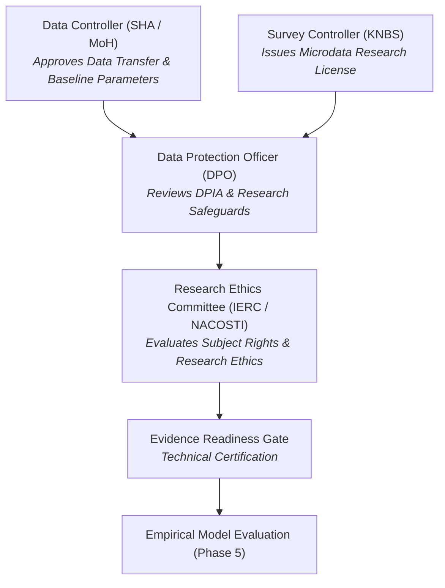

# Data Governance, Privacy & Evidence Readiness Protocol
**SHA Means-Testing Reform Research Prototype**  
**Document Classification:** Technical Research Governance Standard  
**Statutory Alignment:** Kenya Data Protection Act, 2019; ODPC Research Guidance Notes (2025); ODPC Health Data Guidance (2024)

---

> ### ⚠️ Institutional Disclaimer
> This document describes technical architecture, data governance principles, and methodological safeguards for an academic and policy research prototype. **It does not constitute formal legal advice or a binding statutory determination.** Any real-world processing of household records, administrative data, or health-related information must be formally authorized by the respective statutory data controllers (the Social Health Authority and Kenya National Bureau of Statistics), audited by a certified Data Protection Officer (DPO), and reviewed by an accredited Institutional Ethics Review Committee (IERC/NACOSTI).

---

## 1. Why This Frontend Prototype Must Not Ingest Real Member Data

The current application is a client-side Vite/React simulation designed to explore assessment flows, user experience, and calculation integrity. 

**Real household microdata must NOT be ingested into this frontend prototype for the following technical and legal reasons:**
1. **Lack of Air-Gapped Enclave:** Web browser environments (including `localStorage`, `sessionStorage`, client memory, and browser devtools) are not certified secure research enclaves.
2. **Third-Party Script & Network Risks:** Frontend environments are vulnerable to accidental telemetry leakage, script injection, and browser extensions.
3. **Audit Trail Limitations:** Web client sessions lack cryptographically verifiable, tamper-evident audit logging required for statutory accountability under Section 25 and Section 42 of the Kenya Data Protection Act (DPA).
4. **Permanent Prevention of Accidental Exposure:** By strictly barring file upload components that store raw records in browser storage, this repository guarantees that citizen data cannot accidentally be committed to version control (Git) or leaked through web hosting CDNs.

All empirical data workflows in this prototype operate exclusively on **synthetic fixtures** and **schema manifests** until an authorized, secure backend processing environment is formally commissioned.

---

## 2. Personal, Pseudonymised, and Anonymised Data Under Kenyan Law

A widespread misunderstanding in data modeling is assuming that removing names and National Identity numbers makes data "anonymous." Under the **Kenya Data Protection Act, 2019** and the **ODPC Guidance Notes on Processing for Research Purposes (2025)**, this distinction is legally and operationally critical:

| Category | Statutory Definition | Legal Status under Kenya DPA | Protocol in this Project |
| :--- | :--- | :--- | :--- |
| **Personal Data** | Any information relating to an identified or identifiable natural person (DPA Sec 2). | Fully subject to all DPA principles, consent/statutory basis, and data subject rights. | **PROHIBITED** in frontend prototype. |
| **Pseudonymised Data** | Data processed such that it can no longer be attributed to a specific person without additional separate information (e.g. key-coded records). | **Remains Personal Data.** Pseudonymisation is a security measure, NOT an exemption from data protection law. | **PROHIBITED** in frontend prototype. Requires isolated key management. |
| **Anonymised Data** | Data that does not relate to an identified or identifiable natural person, or personal data rendered anonymous in such a manner that the data subject is **not or no longer identifiable** by any means. | Outside the scope of the DPA, provided re-identification risk is provably negligible. | Only aggregate statistics and certified, synthetic microdata are permitted. |

### The Re-Identification Risk in Means-Testing
Household means-testing questionnaires record dense combinations of attributes: sub-county location, family composition, roof/wall materials, specific livestock counts, and energy sources. In sparse rural clusters or specific urban estates, these quasi-identifiers can re-identify households even when all direct identifiers are deleted. Therefore, **removing identity columns does not establish anonymization.**

---

## 3. Statutory Authority, Purpose Limitation, and Lawful Basis

Under Section 30 (Lawful Processing) and Section 53 (Research, Statistical and Historical Purposes) of the Kenya Data Protection Act, 2019, processing personal data for research purposes is permissible only when:
1. **Lawful Basis:** A recognized legal ground exists (e.g., public interest, statutory mandate under the Social Health Insurance Act 2023, or explicit data-subject consent).
2. **Purpose Limitation:** Data collected for health insurance enrollment or census surveys cannot be repurposed without documented justification, institutional approval, and compliance with ODPC research guidance.
3. **No Commercial Exploitation:** Processing must be strictly non-commercial and aimed at public health policy improvement.

Every entry in the project's [Data Access Register](file:///c:/Users/STD%20USER/Desktop/work/SHA/sha-mvp/src/lib/data-access-register.js) records the exact statutory purpose, requesting party, and legal restrictions.

---

## 4. Secure Data Environment Requirements for Future Phases

Before any real household microdata (such as KNBS KIHBS survey data or SHA historical assessment records) can be processed, a certified **Secure Research Enclave** must be established. The technical requirements include:
- **Zero Internet Egress:** Air-gapped analytical workstations with no public internet routing.
- **Role-Based Access Control (RBAC):** Multi-factor authentication restricted to vetted researchers.
- **Cryptographic Encryption:** AES-256 encryption for data at rest; TLS 1.3 for internal transmission.
- **Immutable Audit Logging:** Every SQL query, Python script execution, and export event logged with non-repudiable timestamps.
- **Export Control / Statistical Disclosure Control (SDC):** Automated suppression of small cells ($N < 5$) to prevent inadvertent disclosure in research outputs.

---

## 5. Data Minimisation and Retention Controls

In accordance with Section 3 of the DPA:
1. **Minimisation:** Only variables strictly necessary to evaluate the Regulation 21 proxy means-testing formula and candidate income models may be requested or extracted. Incidental personal information (e.g. phone numbers, specific names, physical GPS coordinates) must be stripped at source.
2. **Retention Limits:** Microdata licensed for evaluation must have explicit retention timeframes, followed by secure cryptographic erasure once validation benchmarks are concluded.

---

## 6. Data Quality Checks Do Not Establish Empirical Truth

The automated checks implemented in [`data-quality-profiler.js`](file:///c:/Users/STD%20USER/Desktop/work/SHA/sha-mvp/src/lib/data-quality-profiler.js) enforce internal consistency, absence of duplicates, and compliance with documented survey ranges.

**Critical Principle:** Passing a data quality check proves that a dataset is structurally valid for computation; **it does not prove that the reported values represent empirical ground truth.**
- A household may submit structurally valid numbers that misrepresent actual seasonal liquidity.
- A survey respondent may report estimates with recall bias.
- An unusual or extreme value (such as a pastoralist household owning 150 cattle but having zero cash flow) is an economic reality, not data corruption.

For this reason, **our profiler never silently deletes records, clips outliers, or imputes missing values.** Anomalies are flagged for investigation, and never labeled as "fraudulent."

---

## 7. The Necessity of Independent Reference Outcomes

A candidate algorithm cannot be evaluated against its own predictions or against another unverified model:
- Evaluating an AGI model against an illustrative PMT formula only tests mathematical divergence between two computer codes; it provides **zero empirical proof** of accuracy.
- True empirical validation requires **independent reference outcomes** gathered through comprehensive, multi-module survey instruments (e.g., KNBS KIHBS total consumption expenditure aggregates).

---

## 8. Governance Roles and Statutory Responsibilities

Independent empirical evaluation cannot proceed as a purely technical exercise. It requires formal coordination among statutory roles:

1. **Data Controller (SHA / KNBS):** Holds statutory custody of the microdata; determines lawful disclosure terms under Kenyan law.
2. **Data Protection Officer (DPO):** Certifies that the Data Protection Impact Assessment (DPIA) addresses privacy risks and re-identification vectors.
3. **Institutional Ethics Review Committee (IERC / NACOSTI):** Grants ethical clearance for health equity and means-testing research in Kenya.
4. **Technical Research Team (Antigravity / Reform Authors):** Operates the analytical framework strictly within authorized boundaries, publishing reproducible methodologies without commercial conflict.

---

## 9. Official Regulatory References
- **Kenya Data Protection Act, 2019** ([Kenya Law](http://kenyalaw.org/kl/fileadmin/pdfdownloads/Acts/2019/TheDataProtectionAct__No24of2019.pdf))
- **ODPC Guidance Notes on Processing for Research Purposes (2025)** ([ODPC Portal](https://www.odpc.go.ke/wp-content/uploads/2025/11/ODPC-%E2%80%93-GUIDANCE-NOTES-Processing-for-Research-Purpose.pdf))
- **ODPC Guidance Note on Processing of Health Data (2024)** ([ODPC Portal](https://www.odpc.go.ke/wp-content/uploads/2024/02/ODPC-Guidance-Note-on-Processing-of-Health-Data.pdf))
- **Social Health Insurance (General) Regulations, 2024** (Regulations 17 and 21; Note: Fifth Schedule is titled 'Zones' under Regulation 62(3)).
