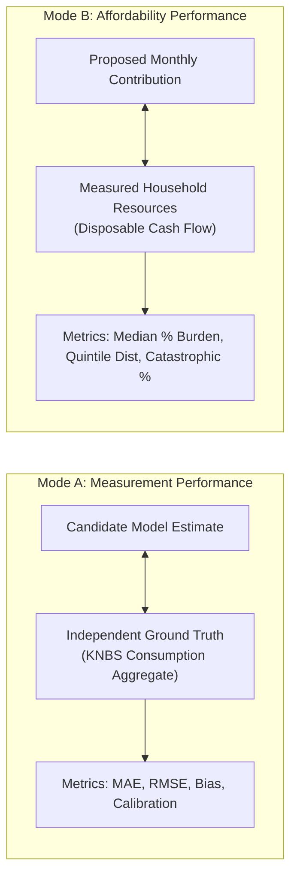

# Empirical Evaluation Protocol & Controlled Benchmarking Standard
**SHA Means-Testing Reform Research Prototype**  
**Document Classification:** Technical Methodology & Scientific Evaluation Standard  
**Applicability:** Pre-Registered Model Evaluation, Controlled Paired Benchmarking, and Offline Shadow Testing

---

> ### ⚠️ Fundamental Methodological Boundary
> **Evaluation results calculated on synthetic demonstration data test software execution only.** They do NOT establish empirical accuracy, fairness, or legal superiority of any candidate model over the Social Health Authority's (SHA) deployed Means Testing Instrument. Authoritative empirical conclusions require formally licensed survey microdata (e.g., KNBS KIHBS) and official SHA baseline parameters.

---

## 1. Two Separate Evaluation Modes: Measurement Accuracy vs. Affordability

A critical error in means-testing reform is conflating how accurately an algorithm measures household capacity with how affordable the resulting contribution schedule is.

Phase 5 strictly decouples these two research questions:

### Why This Separation Matters
Consider an illustrative household with independently measured monthly disposable resources of KSh 12,000:
- **Official SHA PMT Reference:** KSh 850 / month
- **Original AGI v2.1:** KSh 500 / month
- **Declared-Income AGI:** KSh 650 / month

Original AGI v2.1 produces the lowest monetary contribution. **That alone provides zero proof that it measures household capacity more accurately.** 
- If a model systematically underestimates capacity across the population, it compromises the financial solvency of the Social Health Insurance Fund (SHIF).
- Conversely, an algorithm that accurately predicts high statistical wealth from asset indicators (e.g. an inherited rural stone house) may impose contributions that are completely unaffordable given the household's actual liquid cash flow.

Therefore, **Mode A (Predictive Accuracy)** and **Mode B (Affordability Burden)** must be measured, reported, and debated as separate policy dimensions.

---

## 2. Construct Comparability & The Prohibition of Manufactured Rankings

Candidate models operating in this project estimate fundamentally distinct economic constructs:
1. **Official SHA Regulation 21 PMT:** An econometric regression estimating logarithm of per-capita household consumption expenditure.
2. **Original AGI v2.1:** An assessment base combining declared income, contextual asset amortizations, and liquidity friction penalties.
3. **Declared-Income AGI:** A cash-flow capacity measure derived from structured informal-sector net earnings ledgers.
4. **Illustrative PMT Comparator:** A simplified 2-variable heuristic proxy.

### Strict Governance Safeguard
The evaluation engine will **refuse to calculate predictive accuracy metrics** between incompatible model outputs and reference targets:
> *"COMPARISON BLOCKED: The selected candidate models do not produce comparable outputs for the selected reference outcome. Candidate model output constructs cannot be mapped to the target without introducing unsupported assumptions."*

Evaluators must **never manufacture arbitrary conversion factors** to force comparability.

---

## 3. Controlled Dataset Partitioning & Leakage Prevention

To prevent data snooping, model over-fitting, and optimistic performance bias, empirical datasets must be partitioned into three isolated subsets:

| Partition | Proportion | Permitted Research Purpose | Restriction |
| :--- | :--- | :--- | :--- |
| **Development** | 50% | Feature exploration, model fitting, and specification tuning. | Unrestricted for training. |
| **Calibration** | 20% | Bracket thresholds, shrinkage adjustments, and adapter calibration. | No re-fitting of core features. |
| **Held-Out Evaluation** | 30% | Final independent benchmarking of frozen models. | **STRICTLY FROZEN.** Zero parameter tuning permitted. |

### The Household Grouping Key Safeguard
In household budget surveys, individual records often represent multiple members of the same family or repeated visits across agricultural seasons. 
- Splitting records randomly across partitions results in **household leakage**, where a model is evaluated on individuals whose family members were in the training set.
- Our partitioning engine ([`evaluation-partitioning.js`](file:///c:/Users/STD%20USER/Desktop/work/SHA/sha-mvp/src/lib/evaluation-partitioning.js)) groups all records by `householdGroupingKey` (e.g. `hhid`), using a deterministic hash bucket. All observations for a household are assigned to the **exact same partition**, guaranteeing **zero data leakage**.

---

## 4. Subgroup Disaggregation & Small-Cell Suppression

To ensure that candidate algorithms do not produce geographic or demographic inequities, performance is disaggregated across:
- **Settlement Type:** Urban vs. Rural
- **County:** Kenya's 47 devolved counties
- **Household Demographics:** Size bands, female-headed households, elderly dependency ratios
- **Livelihood Sector:** Salaried formal, agriculture/pastoralist, informal small business, casual labor

### Disclosure Protection & Small-Cell Suppression
Any subgroup slice containing fewer than 5 households ($N < 5$) is **automatically suppressed** (`isSuppressed: true`). This protects research subjects against deductive re-identification and prevents drawing misleading policy conclusions from statistically unrepresentative sub-samples.

---

## 5. Statistical Uncertainty & Complex Survey Design

Kenya National Bureau of Statistics (KNBS) surveys utilize multi-stage stratified cluster sampling (NASSEP master frames).
- Standard random-sampling assumptions underestimate standard errors, resulting in artificially narrow confidence intervals.
- The evaluation engine checks for the presence of primary sampling units (clusters), strata, and household expansion weights.
- If survey design metadata is missing, the engine returns **`UNCERTAINTY_NOT_ESTIMABLE`** rather than fabricating unweighted confidence intervals.

---

## 6. Offline Shadow Replay vs. Controlled Operational Pilots

The Offline Shadow Replay engine ([`shadow-replay.js`](file:///c:/Users/STD%20USER/Desktop/work/SHA/sha-mvp/src/lib/shadow-replay.js)) provides retrospective simulation on previously collected data.

**What Offline Shadow Replay Can Establish:**
- The statistical divergence between candidate formulas and historical assessments.
- Aggregate revenue implications for the SHIF under alternative contribution schedules.
- System stability and failure rates on edge-case inputs.

**What Offline Shadow Replay CANNOT Establish:**
- Behavioral responses: how real households respond to different assessment questions.
- Fraud and evasion dynamics in live registration workflows.
- Field operational feasibility: Community Health Promoter (CHP) verification workloads.

Offline shadow replay is a preparatory research step; it can never substitute for a **formal, controlled operational pilot** conducted with the Social Health Authority and Ministry of Health.

---

## 7. Pre-Registration & Audit Invariants

1. **Protocol Freezing:** Research questions, primary metrics, and exclusion criteria must be registered in [`evaluation-protocol.js`](file:///c:/Users/STD%20USER/Desktop/work/SHA/sha-mvp/src/lib/evaluation-protocol.js) prior to examining evaluation holdouts.
2. **Versioned Revisions:** Any post-hoc modification to exclusions or metrics creates a new protocol version requiring documented justification.
3. **Zero Mutation:** Replay and evaluation runs never modify source dataset records or historical assessment snapshots.
4. **No Third-Party Transmission:** All evaluations run strictly locally within memory; no citizen records are written to browser storage or external analytics.
