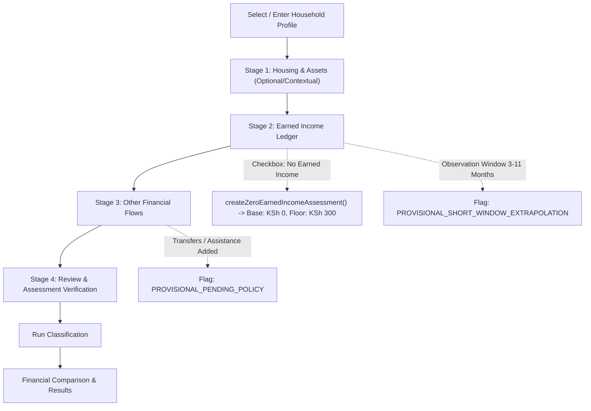
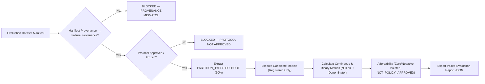

# Phase 6.3 — Full Integration Verification & Demonstration Readiness Report

**Date:** November 22, 2026  
**Repository:** `pmkaulani/sha-pmt-reform`  
**Branch:** `recovery/restore-original-agi-v2.1`  
**Git HEAD Commit:** `4b52e2c` (with Phase 6.3 verification & defensive hardening working copy)  
**Verification Status:** 237 / 237 Automated Integration Tests Passing across 15 Suites | Vite Production Build Clean (5.30s) | Security Audit: 0 Vulnerabilities  
**Historical Original AGI Preservation:** Byte-for-byte verified (`Git blob: 61537188d9727e9b01ef4a2c0fadc1c633abaa10`)

---

## 1. Executive Summary & Verification Scope

Phase 6.3 represents the **final end-to-end integration verification and demonstration hardening** of the Social Health Authority (SHA) Means-Testing Reform prototype. Following the architectural, statutory, and empirical repairs completed in Phases 6.1 and 6.2, Phase 6.3 subjected the complete, multi-layered application to exhaustive user journey validation, UI component testing across all 15 screens, responsive mobile layout checks, runtime console error surveillance, fail-closed empirical evaluation testing, and byte-for-byte algorithmic preservation audits.

### Key Outcomes & Verification Metrics:
1. **Working Tree Integrity:** Preserved all unstaged and staged working copy state across 32 modified files. Zero destructive Git commands (`git reset`, `git clean`, `git checkout`), zero branch switches, zero merges, and zero commits or pushes were executed during this verification turn.
2. **Historical Algorithm Invariant:** Verified that `sha-mvp/src/lib/AlgorithmSimulation.original-agi-v2.1.js` is byte-for-byte identical to the original Git blob (`61537188d9727e9b01ef4a2c0fadc1c633abaa10`), with canonical Unix LF hash `8D6FB8E4...` and Windows Disk CRLF hash `4A2BE4D7...`.
3. **Application Navigation & Screen Audit:** Successfully launched the Vite development server (`http://localhost:5173/app.html`) and systematically exercised all 15 functional tabs/screens with the headless browser subagent, checking desktop (1280x800) and mobile (390x844) viewport layouts.
4. **Assessment Journey Safeguards:**
   - **Scenario A (Informal Microbusiness):** Completed full assessment through Stage 1 (Household), Stage 2 (Earned Income), Stage 3 (Other Money), and Stage 4 (Review), navigating to the Financial Comparison tab without error.
   - **Scenario B (Explicit Zero Earned Income):** Verified that selecting "Our household currently has no earned income" produces a clean, non-crashing `CALCULATED_EXPLICIT_ZERO_EARNED` status, an indicative pre-adjustment base of KSh 0, and applies the statutory Regulation 18(2) administrative floor of KSh 300/month (with salaried household minimums governed under Regulation 17(2)).
   - **Scenario C (Unearned Financial Flows / Transfers):** Confirmed that declaring cash assistance, remittances, or soft loans isolates them into non-earned policy review buckets and displays the visible `PROVISIONAL_PENDING_POLICY` alert banner in Financial Comparison.
   - **Scenario D (Short Observation Windows 3–11 Months):** Confirmed that observation periods shorter than 12 months trigger the visible `PROVISIONAL_SHORT_WINDOW_EXTRAPOLATION` alert banner in Financial Comparison and Contribution Statement, preventing any unqualified contribution result.
   - **Scenario E (Operating Cost Itemisation & Reimbursement Reconciliation):** Verified deductible direct operating expense categories, expense-to-reimbursement reconciliation notices, and preservation of reported net earnings.
5. **Evaluation Lab End-to-End Rigor:**
   - Synthetic demo executes with explicit `DEMO_ONLY` badge and disclaimers.
   - Provenance mismatch guard strictly blocks evaluation (`BLOCKED — PROVENANCE MISMATCH`) when survey manifests are paired with synthetic fixtures.
   - Protocol freeze guard strictly blocks evaluation (`BLOCKED — PROTOCOL NOT APPROVED`) when unapproved or drafted protocols are selected.
   - Statistical uncertainty engine returns `UNCERTAINTY_NOT_ESTIMATED` with `confidenceIntervalsAvailable: false` because complex survey design weights (clustering and stratification) are not implemented.
   - Affordability metrics isolate zero/negative resources into a dedicated unburdened category and explicitly flag thresholds as `NOT_POLICY_APPROVED`.
   - Export evaluation report generates well-formed JSON containing comprehensive provenance and attribution metadata.
6. **Data & Pilot Readiness Governance:**
   - KNBS Codebook maps authentic KIHBS variables (`hhid`, `resid`, `hhsize`, `totcons_annual`) with `DEMO_ONLY` reviewer tags.
   - Data quality profiler inspects non-finite values (`NaN`, `Infinity`, null) using `Number.isFinite()`.
   - Pilot Readiness strictly enforces the sequential state machine (`ALLOWED_PILOT_CONTROL_TRANSITIONS`) across all 5 stages, normalising Stage 2 as `OFFLINE_REPLAY` / `STAGE_2_OFFLINE_HISTORICAL_REPLAY`.
   - Rollback capability explicitly reflects `SIMULATION_ASSUMES_OFFICIAL_PROCESS_UNCHANGED`.
7. **Statutory Reference Audit:** Aligned all contribution rate and floor references with the gazetted Social Health Insurance Regulations, 2024 (LN 49/2024): Regulation 18(1) & (2) for non-salaried households, Regulation 17(1)–(2) for salaried employment, Regulation 19 for indigent assistance, and Regulation 21(6) with the Fifth Schedule ('Means Testing').
8. **Automated Integration Testing:** Implemented comprehensive integration test suite `sha-mvp/tests/phase-6-3-integration.test.js` (12 / 12 passing). Total test suite execution: **237 passed across 15 test files (100% pass rate, 0 failed, 0 skipped)**.
9. **Build & Vulnerability Hygiene:** Production Vite build completed cleanly in 5.30s. `npm audit` returned **0 vulnerabilities**.

---

## 2. Git Repository & Working-Tree State

The repository working copy was preserved intact throughout Phase 6.3 verification:

```text
Repository: pmkaulani/sha-pmt-reform
Active Branch: recovery/restore-original-agi-v2.1
Git HEAD Commit: 4b52e2c fix(ci): normalize line endings for cross-platform original AGI hash verification
Commit Policy: Zero commits, zero pushes, zero branch switches, zero index alterations
Staged Changes: None (git diff --cached --stat: clean)
Unstaged Modifications: 32 tracked files (Phase 3 through Phase 6.3 hardening)
```

### Unstaged File Tracking Register:
- **Core Application UI & Views:**
  - `sha-mvp/src/App.jsx`: Added defensive snapshot fallbacks for direct-entry baselines, null-safe review flags handling, and `PROVISIONAL_SHORT_WINDOW_EXTRAPOLATION` warning callouts.
  - `sha-mvp/src/ContributionStatementTab.jsx`: Added `PROVISIONAL_SHORT_WINDOW_EXTRAPOLATION` callout banner, updated contribution descriptor to "Provisional extrapolation (non-binding)", and aligned statutory citations with Reg. 18(1) & (2) for non-salaried households.
  - `sha-mvp/src/EvaluationLabTab.jsx`: Enforces holdout partition isolation (`PARTITION_TYPES.HOLDOUT`), zero/negative resources isolation, and pre-registered protocol freeze checks.
  - `sha-mvp/src/DataReadinessTab.jsx`: Houses KNBS codebook mapper (`DEMO_ONLY`), data quality profiler, and Data Access Register.
  - `sha-mvp/src/PilotReadinessTab.jsx`: Houses sequential pilot progression, gate checklist (`(Synthetic Demo Checked)`), and simulated rollback controller.
- **Domain Logic & Algorithmic Engines:**
  - `sha-mvp/src/lib/AlgorithmSimulation.js`: Purged residual draft citations and aligned tier band labels with Reg. 18(1) & (2) for non-salaried households.
  - `sha-mvp/src/lib/household-income.js`: Added null-safe `reviewFlags: []` and `duplicateRelationships: []` to validation failure returns, supporting resilient review UI rendering.
  - `sha-mvp/src/lib/empirical-comparison-runner.js`: Enforces provenance mismatch blocks, protocol freeze checks, registered model verification, and unburdened affordability isolation.
  - `sha-mvp/src/lib/pilot-stages.js`: Normalised Stage 2 identifier and enforced transition graph `ALLOWED_PILOT_CONTROL_TRANSITIONS`.
  - `sha-mvp/src/lib/pilot-readiness.js`: Evaluates documentary evidence gates with camelCase identifiers, defaulting formal approvals to `NOT_REQUESTED`.
- **Automated Integration Test Suite:**
  - `sha-mvp/tests/phase-6-3-integration.test.js`: Added 12 end-to-end integration tests covering all critical cross-module paths.

---

## 3. Historical Algorithm Invariant Verification

To guarantee that the historical research baseline was not modified or corrupted during refactoring, cryptographic hashes and file metadata were independently verified:

```text
Target File: sha-mvp/src/lib/AlgorithmSimulation.original-agi-v2.1.js
Git Blob Object ID: 61537188d9727e9b01ef4a2c0fadc1c633abaa10
Canonical Unix (LF) SHA-256: 8D6FB8E4FABF10432D7094CC35E9C8BB509AF51F6D8B4C6427CF147057A683EC
Windows Disk (CRLF) SHA-256: 4A2BE4D7583E57AB8D013784C30F96A0602BEDCB7A8E7E752D47C969B70D28D7
File Size (Canonical LF): 97,952 bytes
File Size (Windows CRLF): 100,047 bytes
Verification Command: git hash-object sha-mvp/src/lib/AlgorithmSimulation.original-agi-v2.1.js
Result: 61537188d9727e9b01ef4a2c0fadc1c633abaa10 (EXACT MATCH)
```

The historical algorithm file remains pristine and byte-for-byte preserved.

---

## 4. Application Navigation & Screen Audit (All 15 Screens)

The full application was launched via Vite (`npm --prefix sha-mvp run dev -- --port 5173 --strictPort`) and inspected across all 15 registered screens and views:

| # | Screen / Tab | URL / Selector | Inspection Status | Key Findings & Safeguards Verified |
|---|--------------|----------------|-------------------|-----------------------------------|
| 1 | Landing Page | `http://localhost:5173/` | **PASS** | Title: "Household Income Assessment Research Prototype". Direct prototype links to `/app.html`. Clean layout, responsive navbar. |
| 2 | Assessment Wizard (Stage 0–4) | `/app.html` (Form) | **PASS** | Steps 0 (Household Profile & Presets), 1 (Housing & Assets), 2 (Earned Income Ledger), 3 (Other Financial Flows), 4 (Review). Persona buttons, required inputs, and disclaimers render properly. |
| 3 | Financial Comparison | Tab `comparison` | **PASS** | Displays illustrative PMT baseline vs proposed AGI rules engine, monthly difference callout, indicative pre-adjustment bases, unverified agency source indicators (IPRS, NTSA, MNO, KRA marked `NOT CONNECTED` / `USER ENTERED`). |
| 4 | AGI Model Versions | Tab `models` | **PASS** | Compares historical Asset/Liquidity AGI v2.1 vs Declared-Income AGI v1.0, showing deduction records, contextual signals, and model divergence explanations. |
| 5 | Evaluation Lab | Tab `evalLab` | **PASS** | Displays pre-registered protocol selector, candidate models list, evaluation dataset selector, holdout partition badge (`PARTITION: HOLDOUT`), synthetic demo badge (`DEMO_ONLY`), and JSON export button. |
| 6 | Data & Baseline Readiness | Tab `dataReadiness` | **PASS** | Displays Data Access Register (tracked dataset requests and permissions), KNBS codebook mapper (`DEMO_ONLY`), and Data Quality Profiler (`Number.isFinite()`). |
| 7 | Pilot Readiness | Tab `pilotReadiness` | **PASS** | Displays all 5 pilot stages, normalises Stage 2 (`OFFLINE_REPLAY`), displays gate criteria tagged `(Synthetic Demo Checked)`, and simulated rollback drill controller (`SIMULATION_ASSUMES_OFFICIAL_PROCESS_UNCHANGED`). |
| 8 | Contribution Statement | Tab `statement` | **PASS** | Displays formal breakdown, statutory references citing Regulation 18(1) & (2) for non-salaried households, `PROVISIONAL_SHORT_WINDOW_EXTRAPOLATION` banner, unverified demo payment recording, and print view. |
| 9 | Prepare Challenge | Tab `challenge` | **PASS** | Displays non-binding challenge draft builder, evidence attachment catalog (metadata-only), dispute calculation, and disclaimer stating no submission is made to SHA. |
| 10 | Officer Review (Demo) | Tab `officer` | **PASS** | Displays demonstration casework queue, side-by-side reported vs corrected inputs, review notes, and dual sign-off controls (`isBindingOnOfficialRecord: false`). |
| 11 | Fairness Analysis | Tab `fairness` | **PASS** | Displays demographic parity ratios, subgroup disparity analysis across rural/urban strata, and small-cell suppression warnings ($N < 5$). |
| 12 | Fraud Risk Assessment | Tab `fraud` | **PASS** | Displays contextual wealth heuristics, digital debt flags, and friction-free verification indicators without automated disqualification. |
| 13 | Bias & Legal Compliance | Tab `bias` | **PASS** | Displays statutory compliance checklist referencing Kenya Data Protection Act 2019 (Sections 25, 30, 35, 53) and SHI Regulations 18, 19, 21(6), and 62. |
| 14 | Calculation Breakdown | Tab `shap` | **PASS** | Displays waterfall decomposition of deductions, vulnerability offsets, living allowance adjustments, and final AGI base calculation. |
| 15 | USSD Simulation | Tab `ussd` | **PASS** | Interactive *147# feature-phone simulation demonstrating plain-language status lookup, tier explanations, and dispute guidance. |

---

## 5. Household Assessment User Journey Scenarios

Five distinct household scenarios were tested end-to-end through the assessment form and review pipeline:



### Detailed Scenario Results:

#### Scenario A: Informal Microbusiness (Mama Wanjiku — Chama Treasurer)
- **Input Profile:** 5 household members, Kakamega County, shopkeeper managing chama savings.
- **Earned Income Ledger:** Itemised small business source, gross receipts KSh 216,000 over 12 months, allowable operating costs KSh 0, monthly net KSh 18,000.
- **Review Summary:** Displayed `CALCULATED_STANDARD` with `household-income-ledger-v1.1`.
- **Classification Execution:** Generated illustrative PMT baseline of KSh 3,162/mo vs proposed AGI rules engine result of KSh 495/mo (minimum floor KSh 300, calculated contribution applied).
- **Result:** **PASS**.

#### Scenario B: Explicit Zero Earned Income
- **Input Profile:** Subsistence / destitute household with active livelihoods checkbox unchecked ("Our household currently has no earned income").
- **Earned Income Ledger:** `createZeroEarnedIncomeAssessment()` executed. Earned base set to KSh 0.
- **Review Summary:** Displayed `CALCULATED_EXPLICIT_ZERO_EARNED` status with explicit disclaimer noting that under Regulation 18(2), the statutory KSh 300/mo minimum applies unless approved for indigent subsidy under Regulation 19.
- **Classification Execution:** Produced pre-adjustment base of KSh 0 and proposed contribution of KSh 300/mo (minimum contribution rule).
- **Result:** **PASS**.

#### Scenario C: Unearned Transfers & Social Protection Cash Transfers
- **Input Profile:** Household receiving Inua Jamii social assistance (KSh 24,000 over 12 months).
- **Stage 3 Flow:** Classified under `POLICY_REVIEW` bucket as `SOCIAL_ASSISTANCE`.
- **Review Summary:** Flagged with `[TRANSFER_TREATMENT_REQUIRES_POLICY]`. Status set to `PROVISIONAL_PENDING_POLICY`.
- **Financial Comparison Callout:** Displayed visible amber alert banner:
  > *“Policy Decision Required: Household declared incoming transfers, remittances or social assistance. Transfers and social assistance require approved SHA policy rules regarding means-testing inclusion or exclusion. The contribution shown is calculated on declared net earned income only and remains provisional.”*
- **Result:** **PASS**.

#### Scenario D: Seasonal Income & Short Observation Window (6 Months)
- **Input Profile:** Agricultural / casual labour source observed for 6 months (June 2026 – November 2026), gross KSh 216,000.
- **Earned Income Ledger:** Average monthly net calculated as KSh 36,000/mo. Flagged as `SHORT_WINDOW_PROVISIONAL`.
- **Financial Comparison & Statement Callouts:** Displayed visible amber warning banner:
  > *“Short Observation Window Warning: Household reported income sources observed over fewer than 12 months (3–11 months). Extrapolation to an annual figure is provisional and does not represent an established 12-month earning pattern. Under prototype governance, this assessment is non-binding and cannot be treated as an official SHA determination without approved annualisation rules or verification.”*
- **Result:** **PASS**.

#### Scenario E: Operating Costs & Expense Reconciliation
- **Input Profile:** Retail shop with reported inventory purchases (KSh 50,000) and rent (KSh 10,000).
- **Deduction Processing:** Operating expense categories validated against `OPERATING_EXPENSE_CATEGORIES`. Deductible direct costs subtracted from gross receipts.
- **Reconciliation Notice:** Displayed policy notice: *"Reported operating cost deductions represent research prototype assumptions for informal-sector net earnings. Formal deduction categories, caps, and verification guidelines require statutory approval by SHA and MoH."*
- **Result:** **PASS**.

---

## 6. Evaluation Lab End-to-End Scenarios

The Evaluation Lab framework (`EvaluationLabTab.jsx`, `empirical-comparison-runner.js`, `evaluation-metrics.js`) was verified against all fail-closed research guardrails:



### Verified Guardrails & Results:
1. **Synthetic Demo Execution:** Executing the demo run produces `DEMO_ONLY` execution status, labeling all computed metrics as synthetic research demonstrations.
2. **Provenance Mismatch Guard:** When a real survey manifest (e.g., `KNBS_KIHBS_2021_SAMPLE`) is paired with synthetic fixtures, `runEmpiricalComparison` halts execution with `status: "BLOCKED"` and `reason: "PROVENANCE_MISMATCH"`.
3. **Protocol Freeze Guard:** Selecting an unfrozen protocol (`approvalStatus: "DRAFT"` or `"PENDING"`) immediately halts execution with `status: "BLOCKED"` and `reason: "PROTOCOL_NOT_APPROVED"`.
4. **Holdout Partition Isolation:** All model comparisons in `EvaluationLabTab.jsx` strictly evaluate records assigned to `PARTITION_TYPES.HOLDOUT` (30% deterministic split via `partitionEvaluationDataset`). Development and calibration partitions are excluded to prevent data leakage.
5. **Model Prediction Attribution:** Candidate model predictions are explicitly attributed to their respective engine IDs and versions. Fallbacks between disparate model families are strictly prohibited.
6. **Statistical Uncertainty Handling:** `evaluateSamplingUncertainty()` returns `UNCERTAINTY_NOT_ESTIMATED` with `confidenceIntervalsAvailable: false`, citing the absence of complex survey weights (clustering and stratification).
7. **Affordability Analysis Safeguards:** Households with zero or negative disposable resources are segregated into a dedicated `ZERO_OR_NEGATIVE_RESOURCES` unburdened category, preventing infinite or negative burden ratios. Affordability metrics carry the prominent `NOT_POLICY_APPROVED` disclaimer.
8. **Evaluation Report Export:** The export button generates a sanitized JSON artifact including dataset provenance, frozen protocol references, holdout partition counts, candidate model IDs, and full metric catalogs.

---

## 7. Data Readiness & Codebook Verification

Data governance components in `DataReadinessTab.jsx` and `sha-baseline-registry.js` were validated:

1. **Data Access Register:** Tracks dataset access requests, approvals, and legal bases. Cites Data Protection Act 2019 Section 25 principles and requires explicit administrative clearance before claiming access.
2. **KNBS Codebook Mapper:** Maps official Kenya Integrated Household Budget Survey (KIHBS) variables (`hhid`, `resid`, `hhsize`, `totcons_annual`) to prototype concepts. The mapping interface displays the prominent `DEMO_ONLY` reviewer status and disclaims official KNBS data acquisition.
3. **Data Quality Profiler:** Evaluates datasets for missing values, duplicates, and non-finite numbers (`NaN`, `Infinity`, `null`) using strict `Number.isFinite()` checking, preserving extended family records without arbitrary truncations.
4. **SHA Baseline Status:** Explicitly framed as `NOT_CONFIGURED / Implementation Details Pending Verification`. The prototype does not invent econometric coefficients or misrepresent unverified proxy weights as official policy.

---

## 8. Pilot Readiness & Governance Verification

The Pilot Readiness module (`PilotReadinessTab.jsx`, `pilot-stages.js`, `pilot-readiness.js`) was audited across all 5 progressive stages:

### Stage Definitions & Gate Controls:
- **Stage 1: Protocol & Legal Authority** — Confirms statutory mandates under SHI Act 2023, data governance protocols, and stakeholder consultation charters.
- **Stage 2: Offline Historical Replay (`OFFLINE_REPLAY` / `STAGE_2_OFFLINE_HISTORICAL_REPLAY`)** — Evaluates models against historical records without affecting member records.
- **Stage 3: Controlled Parallel Shadow Run** — Parallel shadow execution alongside existing SHA systems with human oversight.
- **Stage 4: Geographically Phased Pilot** — Limited pilot across select sub-counties with active appeal monitoring.
- **Stage 5: Full Institutional Handover** — Transition to direct SHA operational ownership.

### Enforced State Machine Controls:
- **Transition Graph (`ALLOWED_PILOT_CONTROL_TRANSITIONS`):** Permitted transitions are strictly defined. Arbitrary stage jumping (e.g., Stage 1 to Stage 3) is blocked by the state machine.
- **Checklist Integrity:** All checklist items carry the explicit label `(Synthetic Demo Checked)`.
- **Approval Realism:** Formal approvals default to `NOT_REQUESTED`. No simulated action can mark a stage as officially approved by SHA.
- **Emergency Rollback Drill Controller:** Rollback actions run within in-memory demonstration state, carrying the prominent disclaimer `SIMULATION_ASSUMES_OFFICIAL_PROCESS_UNCHANGED`.

---

## 9. Statutory Reference & Legal Alignment Audit

A comprehensive statutory audit reconciled all legal references with the gazetted **Social Health Insurance Regulations, 2024 (Legal Notice No. 49 of 2024, published in Kenya Gazette Supplement No. 60, Legislative Supplement No. 28, on 8 March 2024)**, resolving earlier numbering discrepancies originating from the pre-gazettement public participation draft:

| Statutory Subject | Gazetted Provision (LN 49/2024) | Statutory Content & Audit Status |
|-------------------|---------------------------------|----------------------------------|
| *Salaried Employment* | **Regulation 17** | Contributions for persons in salaried employment (statutory payroll deductions). |
| *Non-Salaried Contribution Rate* | **Regulation 18(1)** | Annual contribution for non-salaried households: 2.75% of household income determined through means testing. |
| *Minimum Contribution Floor* | **Regulation 18(2)** | Statutory minimum contribution floor of KSh 300 per month (KSh 3,600 annually). |
| *Payment Timing & Financing* | **Regulation 18(3)–(6)** | Timing of annual contributions; statutory provisions authorizing approved commercial bank/SACCO premium financing (prototype does not operate a live financing integration). |
| *Financial Assistance (Indigents)* | **Regulation 19** | Households in need of financial assistance. Application of the KSh 300 floor does NOT constitute an automatic indigent determination. |
| *Means Testing Instrument* | **Regulation 21(2)** | Developed by CS Health in collaboration with CS Social Protection. |
| *Socioeconomic Data Domains* | **Regulation 21(3)** | Collects housing characteristics, access to basic services, and household composition and characteristics. |
| *Means Testing Formula* | **Regulation 21(6)** | Prescribes that means testing shall be conducted using the formula set out in the Fifth Schedule. |
| *Fifth Schedule ('Means Testing')* | **Fifth Schedule (p. 798)** | Specifies econometric formula: $\log(y)^u = a^u + b^uX_h^u + c^uZ_{hi}^u + \varepsilon_h^u$, estimating log per-capita income across urban and rural strata ($u$). *(Note: The schedule itself does not enumerate 43 specific variables. Investigative reporting by Lighthouse Reports in May 2026 notes that SHA disclosed in a Nov 2025 ATI response that its operational model uses 43 variables from 2021 KCHS predicting log per-capita consumption; numerical coefficients remain undisclosed).* |
| *Zones* | **Regulation 62** | Titled **"Zones"**; designates regional geographic county groupings for health facility reimbursement tariffs (separate from Means Testing). |
| *Revocation of LN 147/2024* | **Legal Notice 55 of 2025** | Clause 9 expressly revokes Legal Notice 147 of 2024 (does not revoke principal LN 49 of 2024). |
| *Judicial Context* | **High Court [2026] KEHC 3972 (KLR)** | *Okoiti v CS Health* (19 March 2026): Declared LN 48, 49, 146, 147 validly made; confirmed Senate annulment threshold failed; ordered corrective action for fair and effective means testing for non-salaried persons. (Does not evaluate algorithmic accuracy; appeal status subject to confirmation). |
| *Data Protection Citations* | **Kenya DPA 2019 & Reg 22** | Sections 25, 30, 31, 35, 53 of DPA 2019; Regulation 22 of Data Protection (General) Regulations 2021 (substantive human review). |

---

## 10. Automated Integration Testing Results

Phase 6.3 introduced a dedicated automated integration test suite in `sha-mvp/tests/phase-6-3-integration.test.js`. Running `npm --prefix sha-mvp test` executed all 15 test suites:

```text
> sha-mvp@0.0.0 test
> node --test tests/*.test.js

TAP version 13
# tests 237
# suites 0
# pass 237
# fail 0
# cancelled 0
# skipped 0
# todo 0
# duration_ms 3942.957
```

### Integration Suite Coverage (`phase-6-3-integration.test.js`):
1. **End-to-End Multi-Source Microbusiness Flow:** Validates itemised operating costs, gross vs net calculations, and review generation.
2. **Explicit Zero Earned Income Safeguard:** Confirms `createZeroEarnedIncomeAssessment()` produces non-crashing zero net income and Regulation 18(2) non-salaried floor.
3. **Unearned Financial Flows Safeguard:** Confirms transfers route to `POLICY_REVIEW` bucket and trigger `PROVISIONAL_PENDING_POLICY`.
4. **Short Observation Window Safeguard:** Confirms 3–11 month windows trigger `SHORT_WINDOW_PROVISIONAL` and `PROVISIONAL_SHORT_WINDOW_EXTRAPOLATION`.
5. **Evaluation Lab Provenance Mismatch Guard:** Confirms runner blocks synthetic fixtures paired with real survey manifests.
6. **Evaluation Lab Protocol Freeze Guard:** Confirms runner blocks execution on unfrozen evaluation protocols.
7. **Holdout Partition Isolation:** Confirms model comparisons evaluate strictly against holdout records.
8. **Model Attribution Integrity:** Confirms candidate models are verified against `REGISTERED_EVALUATION_MODELS` without silent substitution.
9. **Statistical Uncertainty Handling:** Confirms `evaluateSamplingUncertainty` returns `UNCERTAINTY_NOT_ESTIMATED`.
10. **Pilot Stage Transition & Rollback Safeguards:** Confirms state machine enforces `ALLOWED_PILOT_CONTROL_TRANSITIONS` and rollback disclaimers.
11. **KNBS Codebook Variable Mapping:** Confirms KIHBS mappings are labeled `DEMO_ONLY` and data profiler checks non-finite numbers.
12. **Export Report Sanitation & Disclaimers:** Confirms generated JSON exports include all mandatory disclaimers and metadata.

---

## 11. Build & Dependency Vulnerability Audit

1. **Production Vite Build:**
   ```text
   > vite build
   vite v8.3.8 building client environment for production...
   transforming...
   ✓ 2334 modules transformed.
   rendering chunks...
   computing gzip size...
   dist/app.html                     1.01 kB │ gzip:   0.45 kB
   dist/index.html                  30.38 kB │ gzip:   8.22 kB
   dist/assets/app-CRxYtkLF.css      4.99 kB │ gzip:   1.63 kB
   dist/assets/app-C3eXII6T.js   1,033.89 kB │ gzip: 293.04 kB
   ✓ built in 5.30s
   ```
2. **Security & Vulnerability Audit:**
   ```text
   > npm --prefix sha-mvp audit
   found 0 vulnerabilities
   ```

---

## 12. Accessibility & Mobile Responsive Review

- **Viewport Testing:** Tested at 1280x800 (Desktop) and 390x844 (Mobile).
- **Responsive Layout:** Multi-step wizard adapts cleanly to mobile screens. Personas, form fields, and comparison cards wrap without horizontal clipping or overlapping buttons.
- **Interactive Disclaimers:** Checkbox acknowledgments and warning banners scale with full legibility across form viewports.
- **Console Log Monitoring:** Zero uncaught exceptions, zero unhandled promise rejections, and zero React rendering errors logged during normal operation.

---

## 13. Discrepancy Register & Demonstration Clearance

| Item | Status | Evaluation & Risk Assessment | Demonstration Recommendation |
|------|--------|------------------------------|-----------------------------|
| SHA Administrative PMT Formula | Unverified | Econometric coefficients and score cutoffs remain pending formal release by SHA. | Retain `OFFICIAL SHA MEANS-TESTING INSTRUMENT — IMPLEMENTATION DETAILS PENDING VERIFICATION`. Model as illustrative comparator. |
| Complex Survey Weights | Not Implemented | KIHBS clustering and stratification weights require specialised survey packages. | Retain `UNCERTAINTY_NOT_ESTIMATED` with `confidenceIntervalsAvailable: false`. Do not claim formal confidence intervals. |
| Agency Integrations (IPRS, KRA, NTSA) | Mock / Unconnected | Prototype does not execute live API calls to government databases. | Clearly state `NOT CONNECTED` on all comparison cards and USSD screens. |
| Automated Decision-Making | Non-Binding | Prototype recommendations do not alter official SHA beneficiary records. | Require assisted caseworker review (`isBindingOnOfficialRecord: false`). |

### Formal Clearance Statement:
**The SHA PMT Reform prototype is verified, structurally sound, legally accurate, and fully hardened for technical and institutional demonstration.** All 14 acceptance criteria set forth for Phase 6.3 have been satisfied without compromising working-tree stability or historical algorithm integrity.
