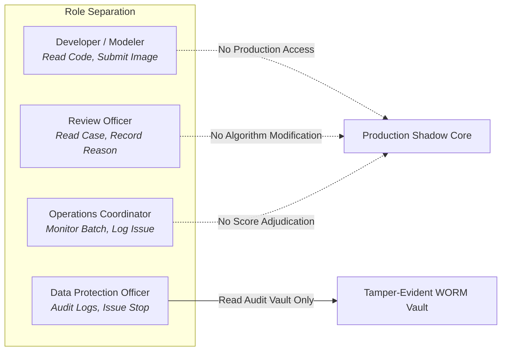

# Security & Privacy Architecture Specification
**SHA Means-Testing Reform Institutional Proposal**  
**Document Classification:** Enterprise Cybersecurity & Data Protection Standard  
**Statutory Standards:** Kenya Data Protection Act, 2019; ISO/IEC 27001; NIST SP 800-53; ODPC Health Data Guidelines (2024)

---

> ### ⚠️ Security Disclaimer & Prototype Boundary
> This document specifies the enterprise security architecture required for a future **production pilot environment deployed under SHA institutional custody**. The current software repository is a research prototype. **Documenting security controls does not replace their implementation and independent audit in a real production environment.** No real citizen financial, identity, or health data is stored in browser storage (`localStorage` / `sessionStorage`), committed to Git, or transmitted over external networks.

---

## 1. Authentication & Identity Management

1. **Enterprise Identity Federation:** Integration with SHA's central identity provider via OpenID Connect (OIDC) / SAML 2.0.
2. **Mandatory Multi-Factor Authentication (MFA):** FIDO2 / WebAuthn hardware security keys required for all administrative, developer, and reviewer access.
3. **Short-Lived Ephemeral Tokens:** JWT access tokens limited to a maximum lifespan of 15 minutes, with automated cryptographic refresh and immediate revocation on suspicious activity.
4. **Service-to-Service Authentication:** Mutual TLS (mTLS) with client certificates issued by an internal SHA private Certificate Authority (CA) for all internal container-to-container calls.

---

## 2. Role-Based Access Control (RBAC) & Separation of Duties

Access is restricted strictly according to the principle of least privilege:

- **Dual-Control Rule:** No single role possesses end-to-end authority to modify model parameters, approve data access, and execute batch runs.
- **Developer Isolation:** Machine learning engineers and software developers have zero access to production shadow databases or live event queues.

---

## 3. Cryptographic Controls & Key Management

| Layer | Standard | Implementation Mechanism |
| :--- | :--- | :--- |
| **Data in Transit** | TLS 1.3 | Strict cipher suites (`TLS_AES_256_GCM_SHA384`), HTTP Strict Transport Security (HSTS, max-age 31536000), internal mTLS. |
| **Data at Rest** | AES-256-GCM | Transparent Database Encryption (TDE) for PostgreSQL/PostGIS; dm-crypt/LUKS for host partition encryption. |
| **Key Storage** | FIPS 140-2 Level 3 | Cloud HSM / On-Premise Hardware Security Module. Keys never exported in plaintext. |
| **Key Rotation** | Automated Annual | Cryptographic keys rotated every 365 days; compromised keys revoked immediately via automated CRL/OCSP stapling. |

---

## 4. Network Segmentation & Air-Gapped Microsegmentation

1. **Air-Gapped Execution Enclave:** The model execution engine resides on a dedicated virtual network (VPC/VNet) with **zero internet egress routes**. DNS resolution is disabled; external IP routing is blocked at the hypervisor firewall.
2. **Read-Only Unidirectional Broker:** Data enters the execution enclave via an asynchronous message diode (unidirectional Kafka consumer). The enclave cannot initiate outbound TCP connections to the SHA core.
3. **DMZ Ingress Boundary:** The human review web portal terminates in a secure DMZ protected by a Web Application Firewall (WAF) enforcing OWASP Top 10 mitigation rules.

---

## 5. Audit Logging & Non-Repudiation (WORM Vault)

1. **Tamper-Evident Event Logging:** Every security, evaluation, and review event is formatted as a structured JSON object, signed with an HMAC key, and shipped to a Write-Once-Read-Many (WORM) storage bucket.
2. **Immutable Timestamps:** NTP time synchronization tied to the National Metrology Institute (NMI) atomic clock reference to prevent log tampering.
3. **Audit Trail Retention:** Audit logs retained in accordance with Public Finance Management regulations and Section 25(1)(g) of the Kenya Data Protection Act.

---

## 6. Cryptographic Identity Governance: Tokenisation, Pseudonymisation, and Anonymisation

A critical technical and legal distinction must be enforced across all system specifications. Replacing direct identifiers with generated identifiers does not automatically create anonymous data:

### Cryptographic Taxonomy:
1. **Hashing (Unkeyed Digest):**
   - *Mechanism:* One-way transformation using algorithms like SHA-256 or deterministic UUIDv5 (RFC 4122 namespace hashing).
   - *Vulnerability:* **UUIDv5 and unkeyed hashes are NOT irreversible anonymisation.** In Kenya, National Identity numbers span a narrow numeric domain (7 to 8 digits, $\approx 50\text{ million}$ possible values). An unkeyed or fixed-namespace hash can be completely reversed in seconds via exhaustive rainbow-table or precomputed dictionary attacks.
   - *Status:* Prohibited as a standalone de-identification method for citizen identifiers.
2. **Keyed Pseudonymisation (HMAC with Secret Pepper):**
   - *Mechanism:* Keyed hash (`HMAC-SHA256`) using an ephemeral secret salt and high-entropy pepper stored strictly in a Hardware Security Module (HSM).
   - *Characteristics:* Deterministic within a single evaluation batch, preventing dictionary enumeration without access to the HSM key.
   - *Legal Status:* **Remains Personal Data** under Section 2 of the Kenya Data Protection Act, 2019. It mitigates casual leakage but does not exempt the system from data protection duties.
3. **Tokenisation (Vault-Based Surrogate Keys):**
   - *Mechanism:* Generation of random, non-mathematical UUIDv4 surrogate tokens linked to the original identity strictly within an isolated, hardware-encrypted Token Vault.
   - *Characteristics:* Zero algorithmic relationship between token and original identity. Blind indexing enables record matching without exposing plaintext keys.
   - *Access Control:* The mapping table is stored in a segregated enclave with dual-control multi-party authorization required for any re-identification query.
4. **Genuine Anonymisation:**
   - *Mechanism:* Irreversible transformation such that the data subject is **not or no longer identifiable by any means reasonably likely to be used**, either by the controller or any other person (including through auxiliary dataset linkage).
   - *Requirements:* Enforces $k$-anonymity ($k \ge 10$), $l$-diversity, and differential privacy noise on quasi-identifiers (e.g. household size, specific livestock counts, sub-location).
   - *Legal Status:* Fully outside the scope of the DPA once certified by an independent disclosure risk audit.
5. **Reversible Encryption:**
   - *Mechanism:* Symmetric ciphertext encryption (`AES-256-GCM`).
   - *Purpose:* Confidential storage and transit protection; reversible only with authorized decryption keys.

### Architectural Requirements for Future Production Tokenisation:
If an identifier tokenisation mechanism is deployed in future SHA pilot phases, it must adhere to the following controls:
- **Cryptographic Selection:** Vault-based random tokenisation or keyed HMAC-SHA256 with high-entropy pepper ($> 128\text{ bits}$).
- **Key Separation:** Encryption keys and token mappings stored in a FIPS 140-2 Level 3 HSM physically separated from calculation databases.
- **Access Restrictions:** Zero access by model developers or evaluators to the token re-identification vault.
- **Attack Resistance:** Salt and pepper defense against dictionary and rainbow-table enumeration; query rate-limiting on token endpoints.
- **Key Lifecycle:** Automated key rotation schedules, compromise revocation protocols, and cryptographic key shredding upon retention expiry.
- **Threat Modeling:** Formal modeling of linkage attacks using external public registries (e.g. voter registers, business registries).

> ### ⚠️ Explicit Prototype Security Boundary Notice
> The existing software repository is a **client-side research prototype**. The cryptographic standards, HSM integrations, Kafka diodes, air-gapped enclaves, and WORM storage vaults documented herein represent **future architectural design specifications**. They are **NOT** deployed in the local web application. **This prototype is NOT certified or secure for storing or processing real citizen personal data.** Real member data must never be uploaded to this application.

---

## 7. Software Supply-Chain & Vulnerability Management

1. **Automated Dependency Auditing:** Continuous integration pipelines enforce `npm audit`, `pip-audit`, and Trivy container vulnerability scanning; zero known critical or high CVEs permitted.
2. **Container Image Signing:** Container images signed using Cosign/Sigstore; kubernetes admission controllers (`Kyverno` / `OPA Gatekeeper`) reject unsigned container images.
3. **Independent Penetration Testing:** Mandatory independent CREST-accredited third-party penetration testing required prior to transitioning beyond Stage 1.
